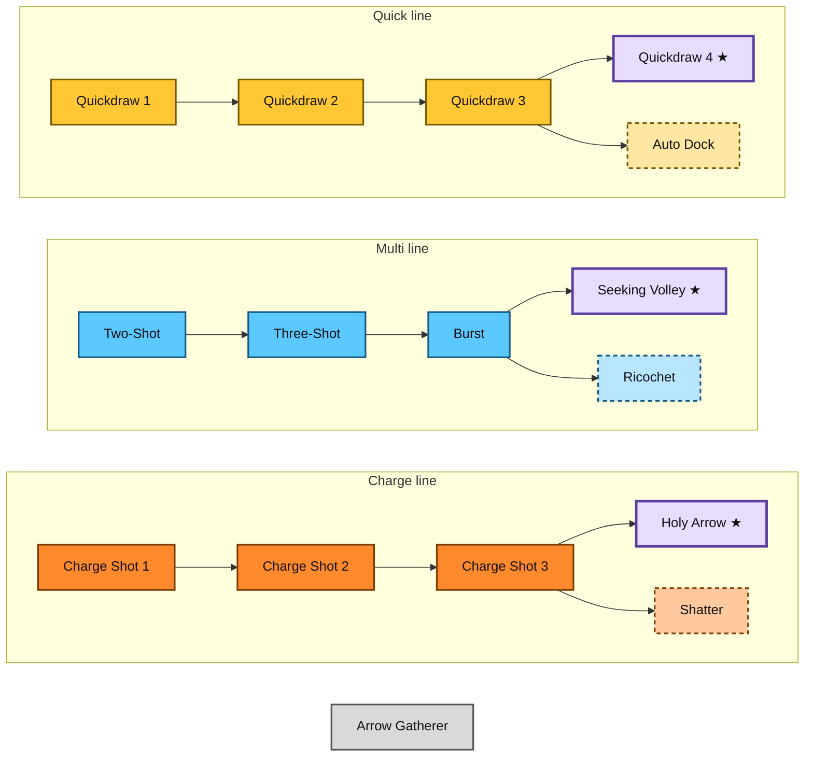
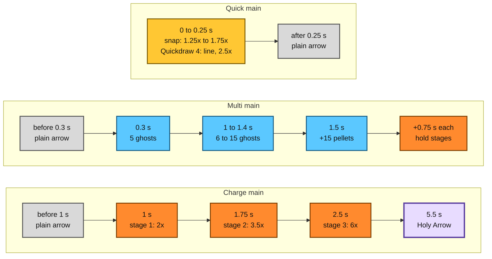

# QuickshotRing

An archery overhaul mod for **A Township Tale** (PC, MelonLoader).
It adds new orbs to the Ranged skill tree at the archery shrine, new shot types, and visual effects that use the game's own art.

## Install

You need:

- MelonLoader **0.7.3**
- The same `QuickshotRing.dll` on **the server and every player's game**. A player without it sees plain arrows; an older copy can disagree with the server.

Steps:

1. Download `QuickshotRing.dll` from the [Releases](../../releases) page.
2. Close the game and the server.
3. Put the DLL in `A Township Tale\Mods\` (game) and in the server's `Mods\` folder.
4. Start the server, then the game. The log `MelonLoader\Latest.log` should show lines starting with `[Archery]`, including `[Archery] Self-check:` (if it says `FAILED`, don't play on that build).

## Skill tree

Open the Ranged tree at the archery shrine. It has three lines of four orbs, three side orbs and the Arrow Gatherer.



Each orb needs the one before it. ★ = legendary, dashed = side orb, grey = on no line (needs nothing). At the shrine, by default, Quick is on the left, Charge in the middle and Multi on the right, with the legendaries on the top row; Shatter sits above Quickdraw 2.

### Your main path

Count the orbs you own on each line (side orbs and the Arrow Gatherer don't count). The line with the most is your **main path**, and only its shot works: Quick archers snap, Multi archers fire volleys, Charge archers charge, and orbs on your other lines add to that shot. On a tie your current path stays; if it isn't one of the tied lines, Charge beats Quick and Quick beats Multi. Before you buy an orb that would switch your path, the shrine gives it a pulsing amber ring and the stone tablet beside the tree says what you would lose.

### What each orb does

Each orb as it works when its line is your main path, with default settings. Times count from the moment your draw passes about two-thirds; 2x means twice your arrow's damage.

| Orb | Needs | What it does |
|---|---|---|
| Quickdraw 1 | nothing | **Snap**: let go within about 0.25 s (a gold ring closes on the arrow tip) for 1.25x damage and a 10% faster arrow. All your shots wobble less. |
| Quickdraw 2 | Quickdraw 1 | Snap 1.5x, 20% faster, steadier. |
| Quickdraw 3 | Quickdraw 2 | Snap 1.75x, 30% faster, steadiest. |
| Quickdraw 4 ★ | Quickdraw 3 | Every snap becomes an instant straight line out to 150 m: 2.5x to the first creature, 1.75x to the second, 1.25x to each one after, up to 8. It stops at anything solid or at a player. |
| Auto Dock | Quickdraw 3 | Keep hold of the bow: about 0.35 s after each shot, the next arrow from your quiver nocks itself. |
| Two-Shot | nothing | **Volley**: from 0.3 s, 5 ghost arrows fly with yours, each doing 15% of your arrow's damage. |
| Three-Shot | Two-Shot | From 1 s, 10 more ghosts join one by one (all 15 by about 1.4 s), 6% each. |
| Burst | Three-Shot | At 1.5 s, 15 pellets join the ghosts (30 extra arrows), 4% each, gone after 30 m. |
| Seeking Volley ★ | Burst | Rest your aim on a creature to lock it (about 0.45 s at 10 m, 0.9 s at 50 m), up to 4 locks. Let go within 25° of a lock and the volley homes in; each ghost flies on from one lock to the next. Your own arrow doesn't fly: 5 ghosts take its place and it ends up where they land. |
| Ricochet | Burst | Ghosts and pellets skip once off the ground. Each arrow that hits a creature jumps to another one within 15 m for half its damage, then bounces once more for half of that. |
| Charge Shot 1 | nothing | **Charged shot**: hold 1 s for 2x damage, a stagger and an interrupt. |
| Charge Shot 2 | Charge Shot 1 | Hold 1.75 s for 3.5x and a bigger stagger. |
| Charge Shot 3 | Charge Shot 2 | Hold 2.5 s for 6x and the biggest stagger. |
| Holy Arrow ★ | Charge Shot 3 | Keep holding the same draw: at 5.5 s it arms. Let go for a golden beam that flies 5x as fast, hits hard, and blasts and stuns creatures within 7 m. |
| Shatter | Charge Shot 3 | When a charged arrow hits a creature, a blast bursts out behind it: other creatures in a 60° cone up to 10 m take up to 2x what the hit dealt (full within 3 m, a quarter at the edges). |
| Arrow Gatherer | nothing | Gathers arrows and feathers into your pouch (Feather Gatherer is merged into it). Arrows you shoot from a quiver go back into it after about 15 s; with RevampedSkills installed, RevampedSkills does that instead. |

Stagger and interrupts hit creatures only. An interrupt cancels what the creature is doing when the game allows it (never Wyrms, at most once every 3 s per creature).

### Combining lines

Orbs on your other lines add to your main shot:

| Main path | + Quickdraw 1-3 | + Two-Shot, Three-Shot, Burst | + Charge Shot 1-3 |
|---|---|---|---|
| **Quick** | its own shot | **Needles**: 1 thin extra arrow per orb on each snap, 15% damage each (needle lines with Quickdraw 4) | **Snap weight**: snaps stagger, more per orb; from 2 orbs they can interrupt |
| **Multi** | **Faster volley**: every volley time 25% shorter per orb (3 orbs: a full volley by about 0.4 s), a 15% tighter spread and 15% quicker Seeking locks per orb | its own shot | **Hold stages**: once the volley is full, each orb adds a stage 0.75 s apart. The ghosts turn gold, and each stage adds 10% ghost and pellet damage and a little stagger |
| **Charge** | **Faster charge**: stages and Holy Arrow 12% sooner per orb (3 orbs: Holy at about 3.5 s), steadier charged shots | **Heavy arrows**: 2 per orb beside each charged shot, 15% damage each (not multiplied by the charge); Shatter's blast +0.15x per orb | its own shot |

- **Side orbs** work on any main path. Auto Dock always works in full (so does the Arrow Gatherer). Off their own line, Ricochet and Shatter work at half strength: any of your arrows that hits a creature can jump, and your arrow's first hit on any shot can shatter (sparing creatures that shot already hurt).
- **One legendary**: you can own only one ★. It works only when its line is your main path, and buying it always makes it so (it is that line's fourth orb). You can still try the others at the shrine; to switch, sell yours first.

### When you let go



- A plain arrow does 1x. Each step needs its orb: Three-Shot for 15 ghosts, Burst for the pellets, Charge Shot 2 and 3 for stages 2 and 3, and one Charge Shot orb per hold stage (orange; the first comes 0.75 s after your volley is full).
- Quick orbs on a Multi or Charge main bring these times forward (see above).
- Relaxing the string for under about 0.35 s loses nothing. A longer relax starts the clock again; that is also how a Quick archer re-arms after a missed snap.

### Example builds

Each uses 8 orbs.

- **Piercer** (Quick main): Quickdraw 1-4, Charge Shot 1-3, Shatter. Every snap is a line through up to 8 creatures (2.5x to the first, less to each after). Each one is staggered (the later ones less), only the first can be interrupted, and Shatter blasts on behind the first at half strength.
- **Swarm** (Multi main): Two-Shot, Three-Shot, Burst, Seeking Volley, Ricochet, Quickdraw 1-3. A full 30-arrow volley by about 0.4 s and locks in about 0.25 to 0.5 s; it homes through up to 4 creatures, and every ghost and pellet hit jumps on.
- **Siege** (Charge main): Charge Shot 1-3, Holy Arrow, Shatter, Two-Shot, Three-Shot, Burst. A 2.5 s hold fires a 6x arrow with 6 heavy arrows beside it, Shatter's blast reaches up to 2.45x the hit, and a 5.5 s hold arms Holy Arrow instead (the beam fires alone: no heavy arrows, no Shatter).

### Buying and selling

- **Try first**: if the server requires it (a game setting), hold the orb at the shrine and use it once before buying. The tablet says what to do, and why an orb can't be bought.
- **Sell from the top down**: unless the server allows selling orbs with children (a game setting), an orb with one of your orbs above it can't be sold.
- **Skill cap**: the game limits skills across all professions. A full archery build is 14 orbs, so you may have to choose.

## Skyfall (admin only)

A server-console skill, not part of the tree. In the server launcher's Console:

```
skyfall                   list who has it
skyfall give <player>     give it (exact name, any case)
skyfall give all          give it to everyone online
skyfall take <player>     remove it
```

To cast: draw fully, aim at least 25° up, hold for 1 second, release. A sigil opens in the sky, giant arrows rain down in 3 waves, then a huge nail drops in the middle. **Everything it hits dies** (creatures and players), except the caster and players within 3 m of where the caster let go.

## Settings

All numbers and colours are in `UserData\QuickshotRing.cfg`. Edits are picked up within 2 seconds while the game runs, except the `[Tree]` switches that add or remove an orb: those need a restart of the server and every game.

- Settings marked `[shared]` must be the same on the server and every player. Compare the `[Archery] Settings: shared checksum` line in both logs.
- `[Log] Level = Debug` gives detailed logs for troubleshooting.
- `[PvP]` controls whether arrows can hurt players (the server's own PvP setting must also be on).
- Custom orb icons: put `<Name>.png` in `UserData\QuickshotRing\Icons\`, where Name is Quickdraw4, TwoShot, ThreeShot, Burst, SeekingVolley, HolyArrow, AutoDock, Ricochet, Shatter or QuiverGather (the Arrow Gatherer).

## Known conflicts

- **RevampedSkills**: if the server and players run different versions, the shrine breaks (no buying or selling). Everyone must run the server's exact mod list.

## Building from source

Requires the .NET SDK and a local copy of the game (the build references its DLLs).

```
dotnet build QuickshotRing -c Release -p:GameDir="C:\path\to\A Township Tale"
```

Output: `QuickshotRing\bin\Release\QuickshotRing.dll`.
Add `-p:Deploy=true` to copy it into the game's `Mods` folder, `-p:DeployServer=true -p:ServerDir="C:\path\to\server"` for the server.

Unit tests:

```
dotnet run --project QuickshotRing.Tests -c Release
```

## Repository layout

| Folder | Contents |
|---|---|
| `QuickshotRing/` | The mod's source (C#). `Resources/` holds the orb icons embedded in the DLL. |
| `QuickshotRing.Tests/` | Unit tests for the game-independent rule files. |
| `Template/` | Empty starting point for a new mod. |
| `tools/` | Test-build menu and install scripts for play-testing. |
| `docs/` | Design specs, plans and play-test notes. |
